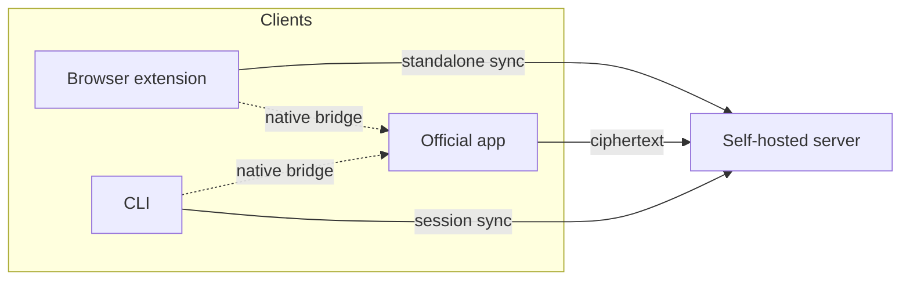

<p align="center">
  
</p>

<h1 align="center">OpenKey</h1>


<p align="center">
  <strong>Open-source, self-hosted, zero-knowledge password manager</strong><br>
  Encrypt on the device. Sync ciphertext only. You keep the keys.
</p>


<p align="center">
  <a href="https://github.com/OpenSelfHosting"></a>
  <a href="./LICENSE"></a>
  <a href="./SECURITY.md"></a>
</p>

<p align="center">
  <a href="https://openkey.openselfhosting.com">Website</a>
  ·
  <a href="https://openkey.openselfhosting.com/guide/security">Security model</a>
</p>

<p align="center">
  Android · macOS · Linux · Windows
</p>

<p align="center">
  <a href="https://apps.microsoft.com/detail/9MXNBRPMDT53"></a>
  &nbsp;&nbsp;
  <a href="https://play.google.com/store/apps/details?id=com.openselfhosting.openkey"></a>
</p>

<p align="center"><a href="https://openkey.openselfhosting.com/guide/download">More platforms and download options →</a></p>

<p align="center">
  <a href="#features">Features</a>
  ·
  <a href="#product-screenshots">Screenshots</a>
  ·
  <a href="#self-host-the-sync-server">Self-hosting</a>
  ·
  <a href="#how-encryption-works">Encryption</a>
  ·
  <a href="#security">Security</a>
</p>

<table>
  <tr>
    <td width="68%" valign="middle" align="center">
      
    </td>
    <td width="32%" valign="middle" align="center">
      
    </td>
  </tr>
  <tr>
    <td align="center"><sub>Desktop — macOS, Windows, Linux</sub></td>
    <td align="center"><sub>Mobile — Android, iOS</sub></td>
  </tr>
</table>

OpenKey is a password manager built so the optional sync server **cannot read your vault**. Clients encrypt collection names, logins, cards, crypto wallets, secrets, and attachments on the device. The server stores opaque ciphertext, KDF parameters, and a wrapped vault key — never the master password.

The OpenKey app and protocol are open source under the MIT License. This repository contains the official Flutter app source, so you can inspect, build, and adapt the app yourself. Official releases are available from [GitHub Releases](https://github.com/OpenSelfHosting/OpenKey/releases) and the [download page](https://openkey.openselfhosting.com/guide/download).


<details>
<summary><strong>Build from source</strong><br></summary>

Build OpenKey from the repository root with Flutter. A server is **not** required to build or use a personal vault offline; configure a self-hosted server only if you want to sync between devices.

```bash
git clone https://github.com/OpenSelfHosting/OpenKey.git
cd OpenKey
```

### Requirements

- Flutter with the Dart SDK version allowed by [`pubspec.yaml`](./pubspec.yaml) (`>=3.12.2 <4.0.0`).
- The native toolchain for your target platform. Run `flutter doctor -v` to see what is installed and what is missing.
- For Android: Android Studio or the Android SDK command-line tools, Android SDK Platform 36, and accepted Android SDK licenses. OpenKey's minimum Android SDK is API 26. Accept licenses with `flutter doctor --android-licenses`.
- For Windows desktop: Windows and Visual Studio with the **Desktop development with C++** workload.
- For Linux desktop: GTK 3 development files, CMake, Ninja, `pkg-config`, a C++ compiler, and the standard build tools (for Debian/Ubuntu, install `build-essential` and `libgtk-3-dev`).
- For macOS or iOS: macOS with Xcode installed and configured. iOS builds also require a valid signing team/device for device installation or distribution; the project deployment targets are macOS 10.15 and iOS 15.5.

### Resolve dependencies

From the repository root:

```bash
flutter pub get
```

Flutter generates the app's localization and native plugin assets as part of the build. You do not need to run code generation separately for a standard build.

### Run the app

List available simulators, emulators, and desktop targets, then pass the chosen device ID to Flutter:

```bash
flutter devices
flutter run -d <device-id>
```

For example, start an Android emulator or connect a device with USB debugging enabled, then use its ID from `flutter devices`. Desktop targets can also be selected by their Flutter target name, such as `linux`, `windows`, or `macos`, when that platform is enabled in your Flutter installation.

### Build a release

Run the command for the platform you want to package:

```bash
# Android APK (sideloading / direct distribution)
flutter build apk --release

# Windows desktop (run on Windows)
flutter build windows --release

# Linux desktop (run on Linux)
flutter build linux --release

# macOS desktop (run on macOS)
flutter build macos --release

# iOS (run on macOS with Xcode)
flutter build ios --release
```

Build outputs are written under `build/` (Android APKs and app bundles are under `build/app/outputs/`). Desktop and iOS builds must be produced on their respective operating systems; cross-compiling between desktop platforms is not supported by these commands.

The Android release build uses a debug signing key unless you provide a release keystore. To create a Google Play-ready bundle, configure your upload keystore in `android/key.properties` (`storeFile`, `storePassword`, `keyAlias`, and `keyPassword`). Keep the keystore and `key.properties` private; never commit them. For iOS distribution, configure signing in Xcode before archiving or uploading the app.

### Check the source

Before submitting changes, run the static analyzer and test suite:

```bash
flutter analyze
flutter test
```

</details>

---

<details>
<summary><strong>Features</strong><br></summary>

One secure home for your passwords, payment details, and developer credentials.

<table>
  <tr>
    <td width="50%" valign="top">
      <strong>Private by design</strong><br>
      <sub>Your vault stays yours</sub>
      <ul>
        <li>Encrypt vault data on your device before it is synced.</li>
        <li>Use a personal vault offline, with no server required.</li>
        <li>When you sync, the server stores encrypted data—not your master password.</li>
      </ul>
    </td>
    <td width="50%" valign="top">
      <strong>Passwords, passkeys &amp; more</strong><br>
      <sub>Keep the details you rely on together</sub>
      <ul>
        <li>Save logins, notes, recovery codes, custom fields, and file attachments.</li>
        <li>Use TOTP two-factor codes and passkeys on supported platforms.</li>
        <li>Store payment cards, crypto wallets, SSH keys, API tokens, and environment snippets.</li>
      </ul>
    </td>
  </tr>
  <tr>
    <td width="50%" valign="top">
      <strong>Organized and easy to search</strong><br>
      <sub>Find the right item quickly</sub>
      <ul>
        <li>Group items into collections and folders, then narrow results with tags and filters.</li>
        <li>Search across your vault and personalize collections with icons.</li>
      </ul>
    </td>
    <td width="50%" valign="top">
      <strong>Autofill that fits your workflow</strong><br>
      <sub>Less typing, fewer interruptions</sub>
      <ul>
        <li>Fill and save credentials with supported system autofill providers or the browser extension.</li>
        <li>Connect the extension to the unlocked desktop app through OpenKey's local bridge.</li>
        <li>Passkey creation and autofill depend on the platform and browser.</li>
      </ul>
    </td>
  </tr>
  <tr>
    <td width="50%" valign="top">
      <strong>Sync on your terms</strong><br>
      <sub>Choose where your encrypted data goes</sub>
      <ul>
        <li>Sync through an optional server that you host and control.</li>
        <li>With Pro, sync directly between nearby devices over your local network—without routing through the API.</li>
      </ul>
    </td>
    <td width="50%" valign="top">
      <strong>Security and recovery controls</strong><br>
      <sub>Protect access and keep a way back in</sub>
      <ul>
        <li>Set auto-lock and use biometric unlock; require biometrics for autofill where supported.</li>
        <li>Enable screenshot protection on supported platforms.</li>
        <li>Create an encrypted full-vault backup or import and export vault data.</li>
      </ul>
    </td>
  </tr>
  <tr>
    <td width="50%" valign="top">
      <strong>Useful tools, built in</strong><br>
      <sub>Generate what you need, when you need it</sub>
      <ul>
        <li>Create passwords, usernames, and email addresses, with password-strength feedback.</li>
        <li>Check credentials locally on your device.</li>
      </ul>
    </td>
    <td width="50%" valign="top">
      <strong>Make OpenKey yours</strong><br>
      <sub>A comfortable setup across your devices</sub>
      <ul>
        <li>Choose themes, colors, fonts, and your preferred language.</li>
        <li>Manage multiple vault accounts from the account switcher.</li>
      </ul>
    </td>
  </tr>
</table>

</details>

---

<details>
<summary><strong>Product screenshots</strong><br></summary>

<h3 align="center">Google Play — Android</h3>

<table>
  <tr>
    <td width="25%" valign="top">
      
      <p align="center"><sub>Vault</sub></p>
    </td>
    <td width="25%" valign="top">
      
      <p align="center"><sub>Passwords and 2FA</sub></p>
    </td>
    <td width="25%" valign="top">
      
      <p align="center"><sub>Cards</sub></p>
    </td>
    <td width="25%" valign="top">
      
      <p align="center"><sub>Password generator</sub></p>
    </td>
  </tr>
  <tr>
    <td width="25%" valign="top">
      
      <p align="center"><sub>Autofill</sub></p>
    </td>
    <td width="25%" valign="top">
      
      <p align="center"><sub>Import and export</sub></p>
    </td>
    <td width="25%" valign="top">
      
      <p align="center"><sub>Nearby sync</sub></p>
    </td>
    <td width="25%" valign="top">
      
      <p align="center"><sub>Self-hosting</sub></p>
    </td>
  </tr>
</table>

<h3 align="center">Microsoft Store — Windows</h3>

<table>
  <tr>
    <td width="50%" valign="top">
      
      <p align="center"><sub>Vault</sub></p>
    </td>
    <td width="50%" valign="top">
      
      <p align="center"><sub>Passwords and 2FA</sub></p>
    </td>
  </tr>
  <tr>
    <td width="50%" valign="top">
      
      <p align="center"><sub>Cards</sub></p>
    </td>
    <td width="50%" valign="top">
      
      <p align="center"><sub>Password generator</sub></p>
    </td>
  </tr>
  <tr>
    <td width="50%" valign="top">
      
      <p align="center"><sub>Import and export</sub></p>
    </td>
    <td width="50%" valign="top">
      
      <p align="center"><sub>Nearby sync</sub></p>
    </td>
  </tr>
  <tr>
    <td width="50%" valign="top">
      
      <p align="center"><sub>Self-hosting</sub></p>
    </td>
    <td width="50%" valign="top">
      
      <p align="center"><sub><strong>Browser autofill</strong> — save and fill credentials</sub></p>
    </td>
  </tr>
</table>
</details>

---

<details>
<summary><strong>OpenKey projects</strong><br></summary>

The ecosystem is modular: the official app works offline, and you can add only the services and tools you need.

| Project | What it does | When to use it |
|---------|--------------|----------------|
| [OpenKey app](https://github.com/OpenSelfHosting/OpenKey) | Official Flutter app for Android, macOS, Linux, and Windows. | Use it as your personal password manager; a server is optional. |
| [OpenKey server](https://github.com/OpenSelfHosting/OpenKey_server) | Self-hosted API for syncing encrypted vault data between devices. | Deploy it when you want server-based sync that you control. |
| [OpenKey browser extension](https://github.com/OpenSelfHosting/OpenKey_extension) | Browser-based vault, autofill, and connection to the unlocked desktop app. | Use it for browser autofill, either standalone with a server or with the desktop app bridge. |
| [OpenKey CLI](https://github.com/OpenSelfHosting/OpenKey_cli) | Terminal tools for password generation and vault items. | Use it in developer workflows with the desktop app bridge or a server session. |
| [OpenKey documentation](https://github.com/OpenSelfHosting/OpenKey_docs) | Product guides and documentation. | Use it for setup instructions and feature guides. |


### How the pieces connect

The app, browser extension, and CLI can each sync with a server. The extension and CLI can also connect to an unlocked desktop app through its local bridge.



Nearby LAN sync (Pro) is peer-to-peer on the local network. It does **not** go through the API.

The product website is [openkey.openselfhosting.com](https://openkey.openselfhosting.com); the company website is [openselfhosting.com](https://openselfhosting.com). Official app releases are available from [GitHub Releases](https://github.com/OpenSelfHosting/OpenKey/releases) and supported app stores. **OpenKey Pro** subscriptions are sold through app stores. See the [Terms of Service](https://openkey.openselfhosting.com/terms) and [Privacy Policy](https://openkey.openselfhosting.com/privacy) for product and service details.

</details>

---

<details>
<summary><strong>Self-host the sync server</strong><br></summary>

The server is optional. Personal vaults work offline. Sync across your devices needs an instance you control.

```bash
git clone https://github.com/OpenSelfHosting/OpenKey_server.git
cd OpenKey_server
cp .env.example .env
openssl rand -hex 32   # paste into JWT_SECRET in .env
docker compose up --build -d
```

API: `http://localhost:8000` · OpenAPI: `/docs` · Health: `/health`

Then in the official app: **Settings → Data → Self-hosted server** → that URL → register or log in → sync.

Production: HTTPS in front of the API, unique `JWT_SECRET` (min 32 characters), explicit `CORS_ORIGINS` (never `*`). Full guide: [Install the server](https://openkey.openselfhosting.com/guide/server).

</details>


---

<details>
<summary><strong>Browser extension</strong><br></summary>

The open-source extension supports Chrome, Edge, Brave, Vivaldi, LibreWolf, and Firefox. Use it with your self-hosted server as a standalone vault, or connect it to an **unlocked desktop app** to fill and save without a separate extension unlock. It can autofill logins and cards, capture updated logins, and work with passkeys.

```bash
git clone https://github.com/OpenSelfHosting/OpenKey_extension.git
cd OpenKey_extension
npm install
npm run build
```

Load the generated `dist/` directory as an unpacked extension in Chromium browsers, or select `dist/manifest.json` from Firefox’s `about:debugging` page. See the [Browser extension guide](https://openkey.openselfhosting.com/guide/extension) for setup, permissions, keyboard shortcuts, and connecting the desktop app.

</details>

---

<details>
<summary><strong>Command-line interface (CLI)</strong><br></summary>

The open-source `openkey` CLI is for managing developer secrets and other vault items from a terminal. Password generation works offline. Vault commands can use the **unlocked desktop app** over its local bridge, or an optional self-hosted server session. Node.js 20+ is required.

```bash
npm install -g openkey-cli
openkey --version
openkey status
```

For server-based use, configure the server, sign in, and unlock a short-lived CLI session:

```bash
openkey config set-server http://localhost:8000
openkey login --email you@example.com
eval $(openkey unlock)
openkey sync
```

On Android, the CLI can also connect to the unlocked app through Termux. See the [CLI guide](https://openkey.openselfhosting.com/guide/cli) for available commands, authentication, Termux setup, and security notes.

</details>

---

<details>
<summary><strong>Security</strong><br></summary>

Report vulnerabilities **privately** to **security@openselfhosting.com** — do not open a public issue for exploitable bugs. See [SECURITY.md](./SECURITY.md).

</details>

---

<details>
<summary><strong>Contributing</strong><br></summary>

Issues and pull requests for bugs, documentation, and improvements are welcome.
Include focused tests with code changes. For security vulnerabilities, use the private reporting
instructions in [SECURITY.md](./SECURITY.md) instead of opening a public issue.

</details>

---

<details>
<summary><strong>License</strong><br></summary>

The OpenKey app and documentation in this repository are licensed under the [MIT License](./LICENSE). Vendored and third-party dependencies retain their respective licenses.

</details>
