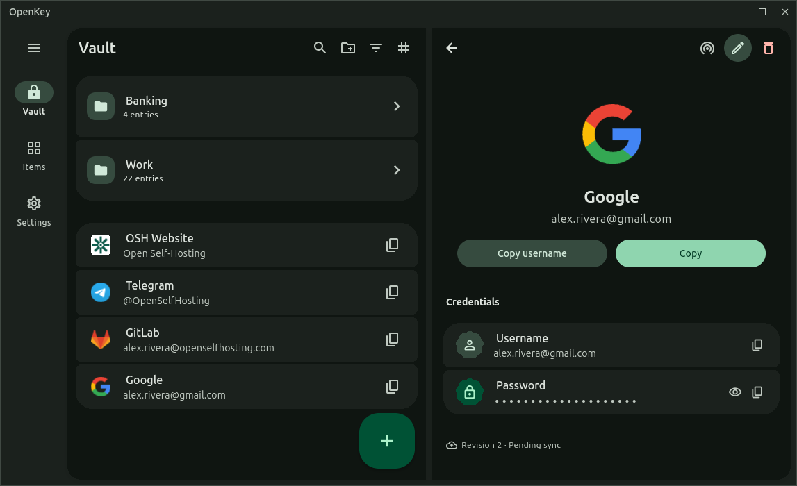
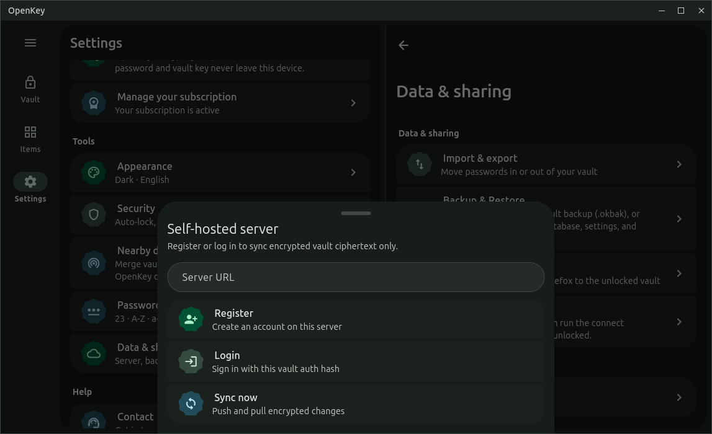
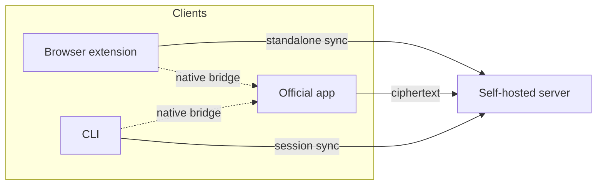

<p align="center">
  
</p>

<h1 align="center">OpenKey</h1>


<p align="center">
  <strong>Open-source, self-hosted, zero-knowledge password manager</strong><br>
  Encrypt on the device. Sync ciphertext only. You keep the keys.
</p>


<p align="center">
  <a href="https://github.com/OpenSelfHosting"></a>
  <a href="./LICENSE"></a>
  <a href="./spec/"></a>
  <a href="./spec/crypto.md"></a>
  <a href="./SECURITY.md"></a>
</p>

<p align="center">
  <a href="https://openkey.openselfhosting.com">Website</a>
  ·
  <a href="./spec/">Protocol spec</a>
  ·
  <a href="https://openkey.openselfhosting.com/guide/security">Security model</a>
</p>

<p align="center">
  Android · macOS · Linux · Windows
</p>

<p align="center">
  <a href="https://apps.microsoft.com/detail/9MXNBRPMDT53"></a>
  &nbsp;
  <a href="https://play.google.com/store/apps/details?id=com.openselfhosting.openkey"></a>
</p>

<p align="center"><a href="https://openkey.openselfhosting.com/guide/download">More platforms and download options →</a></p>

<p align="center">
  <a href="#features">Features</a>
  ·
  <a href="#product-screenshots">Screenshots</a>
  ·
  <a href="#self-host-the-sync-server">Self-hosting</a>
  ·
  <a href="#how-encryption-works">Encryption</a>
  ·
  <a href="#security">Security</a>
</p>

<table>
  <tr>
    <td width="68%" valign="middle" align="center">
      
    </td>
    <td width="32%" valign="middle" align="center">
      
    </td>
  </tr>
  <tr>
    <td align="center"><sub>Desktop — macOS, Windows, Linux</sub></td>
    <td align="center"><sub>Mobile — Android, iOS</sub></td>
  </tr>
</table>

OpenKey is a password manager built so the optional sync server **cannot read your vault**. Clients encrypt collection names, logins, cards, crypto wallets, secrets, and attachments on the device. The server stores opaque ciphertext, KDF parameters, and a wrapped vault key — never the master password.

The OpenKey app and protocol are open source under the MIT License. This repository contains the official Flutter app source, so you can inspect, build, and adapt the app yourself. Official releases are available from [GitHub Releases](https://github.com/OpenSelfHosting/OpenKey/releases) and the [download page](https://openkey.openselfhosting.com/guide/download).


<details>
<summary><strong>Build from source</strong><br></summary>

Install Flutter with a Dart SDK version allowed by [`pubspec.yaml`](./pubspec.yaml), then run:

```bash
flutter pub get
flutter run
```

Select a connected device or desktop target with Flutter's `-d` option. Each target platform may require its own Flutter toolchain and system dependencies.

</details>

---

<details>
<summary><strong>Features</strong><br></summary>

<div align="center">
  <table>
    <tr>
      <td width="25%" valign="top" align="left">
        <strong>Zero-knowledge vault</strong><br>
        Encrypt logins, notes, cards, crypto wallets, secrets, names, and attachments on-device before they ever leave your device.
      </td>
      <td width="25%" valign="top" align="left">
        <strong>Self-hosted sync</strong><br>
        Sync across Android, macOS, Linux, and Windows through a server you control; personal vaults also work entirely offline.
      </td>
      <td width="25%" valign="top" align="left">
        <strong>Autofill &amp; passkeys</strong><br>
        Fill login forms with the desktop app or browser extension, save updated credentials, and use passkeys or TOTP where supported.
      </td>
      <td width="25%" valign="top" align="left">
        <strong>Open protocols</strong><br>
        The app, sync protocol, and server APIs are open source so you can inspect the implementation and build your own stack.
      </td>
    </tr>
  </table>
</div>

- Secure password generation and local-only credential checks
- Collections, tags, and fast search for organized vaults
- Optional LAN sync for Pro users without routing through the API
- Local app bridge and browser extension support for developer workflows and everyday autofill

</details>

---

<details>
<summary><strong>Product screenshots</strong><br></summary>

<table>
  <tr>
    <td width="50%" valign="top">
      
      <p align="center"><sub><strong>Vault</strong> — collections, search, and item types</sub></p>
    </td>
    <td width="50%" valign="top">
      
      <p align="center"><sub><strong>Entry</strong> — password, TOTP, passkey, or card</sub></p>
    </td>
  </tr>
  <tr>
    <td width="50%" valign="top">
      
      <p align="center"><sub><strong>Autofill</strong> — system provider or browser extension</sub></p>
    </td>
    <td width="50%" valign="top">
      
      <p align="center"><sub><strong>Sync</strong> — Settings → Data → Self-hosted server</sub></p>
    </td>
  </tr>
</table>

Capture notes: [`docs/screenshots/README.md`](./docs/screenshots/README.md).

</details>

---

<details>
<summary><strong>OpenKey projects</strong><br></summary>

| Piece | Repository | License |
|-------|------------|---------|
| Official Flutter app | This repository | MIT |
| Protocol spec (KDF, vault payload, sync) | [`spec/`](./spec/) in this repo | MIT |
| Sync server | [OpenKey_server](https://github.com/OpenSelfHosting/OpenKey_server) | MIT |
| Browser extension | [OpenKey_extension](https://github.com/OpenSelfHosting/OpenKey_extension) | MIT |
| Developer CLI | [OpenKey_cli](https://github.com/OpenSelfHosting/OpenKey_cli) | MIT |
| Documentation site | [OpenKey_docs](https://github.com/OpenSelfHosting/OpenKey_docs) | MIT |

An alternative MongoDB API implementation is maintained in `OpenKey_kube_server`;
it is not a drop-in replacement for `OpenKey_server`. Kubernetes overlays are
maintained separately in `OpenKey_kubernetes`.

Product site: [openkey.openselfhosting.com](https://openkey.openselfhosting.com). Company: [openselfhosting.com](https://openselfhosting.com).

Official app releases are attached to **this** repository’s GitHub Releases and are also available through supported app stores. **OpenKey Pro** subscriptions are sold through app stores (RevenueCat). See the [Terms of Service](https://openkey.openselfhosting.com/terms) and [Privacy Policy](https://openkey.openselfhosting.com/privacy) for product and service details.



Nearby LAN sync (Pro) is peer-to-peer on the local network. It does **not** go through the API.

</details>

---

<details>
<summary><strong>Self-host the sync server</strong><br></summary>

The server is optional. Personal vaults work offline. Sync across your devices needs an instance you control.

```bash
git clone https://github.com/OpenSelfHosting/OpenKey_server.git
cd OpenKey_server
cp .env.example .env
openssl rand -hex 32   # paste into JWT_SECRET in .env
docker compose up --build -d
```

API: `http://localhost:8000` · OpenAPI: `/docs` · Health: `/health`

Then in the official app: **Settings → Data → Self-hosted server** → that URL → register or log in → sync.

Production: HTTPS in front of the API, unique `JWT_SECRET` (min 32 characters), explicit `CORS_ORIGINS` (never `*`). Full guide: [Install the server](https://openkey.openselfhosting.com/guide/server).

</details>

---

<details>
<summary><strong>How encryption works</strong><br></summary>

1. `Argon2id(utf8(trim(email).toLowerCase() + ":" + master_password), salt)` → master key
2. Master key → `auth_hash` (HMAC-SHA256 with `"openkey-auth"`, sent to the server) and wraps the vault key
3. Vault key encrypts collection names and entry payloads (**AES-256-GCM**)
4. The server stores salt, KDF params, wrapped vault key, and opaque ciphertext — not the master password

There is no master-password recovery. If it is lost, ciphertext is unrecoverable.

Details: [`spec/crypto.md`](./spec/crypto.md) · [Security](https://openkey.openselfhosting.com/guide/security)

</details>

---

<details>
<summary><strong>Browser extension</strong><br></summary>

The open-source extension supports Chrome, Edge, Brave, Vivaldi, LibreWolf, and Firefox. Use it with your self-hosted server as a standalone vault, or connect it to an **unlocked desktop app** to fill and save without a separate extension unlock. It can autofill logins and cards, capture updated logins, and work with passkeys.

```bash
git clone https://github.com/OpenSelfHosting/OpenKey_extension.git
cd OpenKey_extension
npm install
npm run build
```

Load the generated `dist/` directory as an unpacked extension in Chromium browsers, or select `dist/manifest.json` from Firefox’s `about:debugging` page. See the [Browser extension guide](https://openkey.openselfhosting.com/guide/extension) for setup, permissions, keyboard shortcuts, and connecting the desktop app.

</details>

---

<details>
<summary><strong>Command-line interface (CLI)</strong><br></summary>

The open-source `openkey` CLI is for managing developer secrets and other vault items from a terminal. Password generation works offline. Vault commands can use the **unlocked desktop app** over its local bridge, or an optional self-hosted server session. Node.js 20+ is required.

```bash
npm install -g openkey-cli
openkey --version
openkey status
```

For server-based use, configure the server, sign in, and unlock a short-lived CLI session:

```bash
openkey config set-server http://localhost:8000
openkey login --email you@example.com
eval $(openkey unlock)
openkey sync
```

On Android, the CLI can also connect to the unlocked app through Termux. See the [CLI guide](https://openkey.openselfhosting.com/guide/cli) for available commands, authentication, Termux setup, and security notes.

</details>

---

<details>
<summary><strong>Security</strong><br></summary>

Report vulnerabilities **privately** to **security@openselfhosting.com** — do not open a public issue for exploitable bugs. See [SECURITY.md](./SECURITY.md).

</details>

---

<details>
<summary><strong>Contributing</strong><br></summary>

Issues and pull requests for bugs, documentation, and improvements are welcome.
Keep client behavior aligned with [`spec/`](./spec/), and include focused tests
with code changes. For security vulnerabilities, use the private reporting
instructions in [SECURITY.md](./SECURITY.md) instead of opening a public issue.

</details>

---

<details>
<summary><strong>License</strong><br></summary>

The OpenKey app and documentation in this repository are licensed under the [MIT License](./LICENSE). Vendored and third-party dependencies retain their respective licenses.

</details>
