<p align="center">
  
</p>

<h1 align="center">OpenKey</h1>


<p align="center">
  <strong>Open-source, self-hosted, zero-knowledge password manager</strong><br>
  Encrypt on the device. Sync ciphertext only. You keep the keys.
</p>


<p align="center">
  <a href="https://github.com/OpenSelfHosting"></a>
  <a href="./LICENSE"></a>
  <a href="./SECURITY.md"></a>
</p>

<p align="center">
  <a href="https://openkey.openselfhosting.com">Website</a>
  ·
  <a href="https://openkey.openselfhosting.com/guide/security">Security model</a>
</p>

<p align="center">
  Android · macOS · Linux · Windows
</p>

<p align="center">
  <a href="https://apps.microsoft.com/detail/9MXNBRPMDT53"></a>
  &nbsp;&nbsp;
  <a href="https://play.google.com/store/apps/details?id=com.openselfhosting.openkey"></a>
</p>

<p align="center"><a href="https://openkey.openselfhosting.com/guide/download">More platforms and download options →</a></p>

<p align="center">
  <a href="#features">Features</a>
  ·
  <a href="#product-screenshots">Screenshots</a>
  ·
  <a href="#self-host-the-sync-server">Self-hosting</a>
  ·
  <a href="#how-encryption-works">Encryption</a>
  ·
  <a href="#security">Security</a>
</p>

<table>
  <tr>
    <td width="68%" valign="middle" align="center">
      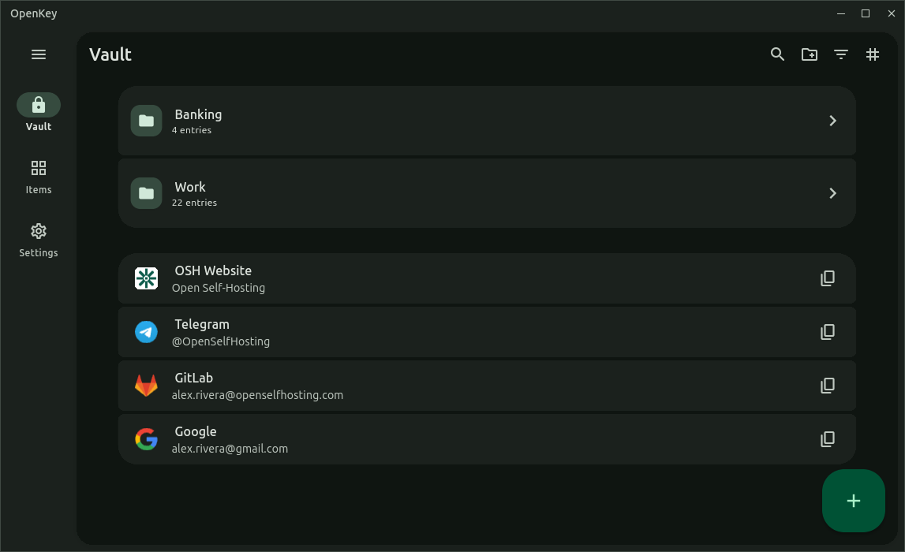
    </td>
    <td width="32%" valign="middle" align="center">
      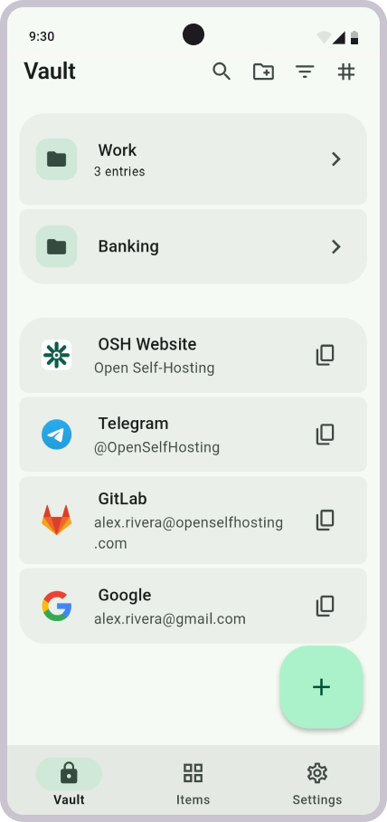
    </td>
  </tr>
  <tr>
    <td align="center"><sub>Desktop — macOS, Windows, Linux</sub></td>
    <td align="center"><sub>Mobile — Android, iOS</sub></td>
  </tr>
</table>

OpenKey is a password manager built so the optional sync server **cannot read your vault**. Clients encrypt collection names, logins, cards, crypto wallets, secrets, and attachments on the device. The server stores opaque ciphertext, KDF parameters, and a wrapped vault key — never the master password.

The OpenKey app and protocol are open source under the MIT License. This repository contains the official Flutter app source, so you can inspect, build, and adapt the app yourself. Official releases are available from [GitHub Releases](https://github.com/OpenSelfHosting/OpenKey/releases) and the [download page](https://openkey.openselfhosting.com/guide/download).


<details>
<summary><strong>Build from source</strong><br></summary>

Build OpenKey from the repository root with Flutter. A server is **not** required to build or use a personal vault offline; configure a self-hosted server only if you want to sync between devices.

Clone the app repository:
```bash
git clone https://github.com/OpenSelfHosting/OpenKey.git
```

Change into the cloned project directory:
```bash
cd OpenKey
```

### Requirements

- Flutter with the Dart SDK version allowed by [`pubspec.yaml`](./pubspec.yaml) (`>=3.12.2 <4.0.0`).
- The native toolchain for your target platform. Run `flutter doctor -v` to see what is installed and what is missing.
- For Android: Android Studio or the Android SDK command-line tools, Android SDK Platform 36, and accepted Android SDK licenses. OpenKey's minimum Android SDK is API 26. Accept licenses with `flutter doctor --android-licenses`.
- For Windows desktop: Windows and Visual Studio with the **Desktop development with C++** workload.
- For Linux desktop: GTK 3 development files, CMake, Ninja, `pkg-config`, a C++ compiler, and the standard build tools (for Debian/Ubuntu, install `build-essential` and `libgtk-3-dev`).
- For macOS or iOS: macOS with Xcode installed and configured. iOS builds also require a valid signing team/device for device installation or distribution; the project deployment targets are macOS 10.15 and iOS 15.5.

### Resolve dependencies

From the repository root:

```bash
flutter pub get
```

Flutter generates the app's localization and native plugin assets as part of the build. You do not need to run code generation separately for a standard build.

### Run the app

List available simulators, emulators, and desktop targets:

```bash
flutter devices
```

Run the app on the target you selected from that list:

```bash
flutter run -d <device-id>
```

For example, start an Android emulator or connect a device with USB debugging enabled, then use its ID from `flutter devices`. Desktop targets can also be selected by their Flutter target name, such as `linux`, `windows`, or `macos`, when that platform is enabled in your Flutter installation.

### Build a release

Build an Android APK for direct installation:

```bash
flutter build apk --release
```

For Google Play, configure release signing as described below, then build an Android App Bundle:

```bash
flutter build appbundle --release
```

Build the Windows desktop app (run this on Windows):

```bash
flutter build windows --release
```

Build the Linux desktop app (run this on Linux):

```bash
flutter build linux --release
```

Build the macOS desktop app (run this on macOS):

```bash
flutter build macos --release
```

Build the iOS app (run this on macOS with Xcode):

```bash
flutter build ios --release
```

Build outputs are written under `build/` (Android APKs and app bundles are under `build/app/outputs/`). Desktop and iOS builds must be produced on their respective operating systems; cross-compiling between desktop platforms is not supported by these commands.

The Android release build uses a debug signing key unless you provide a release keystore. To create a Google Play-ready bundle, configure your upload keystore in `android/key.properties` (`storeFile`, `storePassword`, `keyAlias`, and `keyPassword`). Keep the keystore and `key.properties` private; never commit them. For iOS distribution, configure signing in Xcode before archiving or uploading the app.

### Check the source

Run the static analyzer before submitting changes:

```bash
flutter analyze
```

Run the test suite:

```bash
flutter test
```

</details>

---

<details>
<summary><strong>Features</strong><br></summary>

One secure home for your passwords, payment details, and developer credentials.

<table>
  <tr>
    <td width="50%" valign="top">
      <strong>Private by design</strong><br>
      <sub>Your vault stays yours</sub>
      <ul>
        <li>Encrypt vault data on your device before it is synced.</li>
        <li>Use a personal vault offline, with no server required.</li>
        <li>When you sync, the server stores encrypted data—not your master password.</li>
      </ul>
    </td>
    <td width="50%" valign="top">
      <strong>Passwords, passkeys &amp; more</strong><br>
      <sub>Keep the details you rely on together</sub>
      <ul>
        <li>Save logins, notes, recovery codes, custom fields, and file attachments.</li>
        <li>Use TOTP two-factor codes and passkeys on supported platforms.</li>
        <li>Store payment cards, crypto wallets, SSH keys, API tokens, and environment snippets.</li>
      </ul>
    </td>
  </tr>
  <tr>
    <td width="50%" valign="top">
      <strong>Organized and easy to search</strong><br>
      <sub>Find the right item quickly</sub>
      <ul>
        <li>Group items into collections and folders, then narrow results with tags and filters.</li>
        <li>Search across your vault and personalize collections with icons.</li>
      </ul>
    </td>
    <td width="50%" valign="top">
      <strong>Autofill that fits your workflow</strong><br>
      <sub>Less typing, fewer interruptions</sub>
      <ul>
        <li>Fill and save credentials with supported system autofill providers or the browser extension.</li>
        <li>Connect the extension to the unlocked desktop app through OpenKey's local bridge.</li>
        <li>Passkey creation and autofill depend on the platform and browser.</li>
      </ul>
    </td>
  </tr>
  <tr>
    <td width="50%" valign="top">
      <strong>Sync on your terms</strong><br>
      <sub>Choose where your encrypted data goes</sub>
      <ul>
        <li>Sync through an optional server that you host and control.</li>
        <li>With Pro, sync directly between nearby devices over your local network—without routing through the API.</li>
      </ul>
    </td>
    <td width="50%" valign="top">
      <strong>Security and recovery controls</strong><br>
      <sub>Protect access and keep a way back in</sub>
      <ul>
        <li>Set auto-lock and use biometric unlock; require biometrics for autofill where supported.</li>
        <li>Enable screenshot protection on supported platforms.</li>
        <li>Create an encrypted full-vault backup or import and export vault data.</li>
      </ul>
    </td>
  </tr>
  <tr>
    <td width="50%" valign="top">
      <strong>Useful tools, built in</strong><br>
      <sub>Generate what you need, when you need it</sub>
      <ul>
        <li>Create passwords, usernames, and email addresses, with password-strength feedback.</li>
        <li>Check credentials locally on your device.</li>
      </ul>
    </td>
    <td width="50%" valign="top">
      <strong>Make OpenKey yours</strong><br>
      <sub>A comfortable setup across your devices</sub>
      <ul>
        <li>Choose themes, colors, fonts, and your preferred language.</li>
        <li>Manage multiple vault accounts from the account switcher.</li>
      </ul>
    </td>
  </tr>
</table>

</details>

---

<details>
<summary><strong>Product screenshots</strong><br></summary>

<h3 align="center">Google Play — Android</h3>

<table>
  <tr>
    <td width="25%" valign="top">
      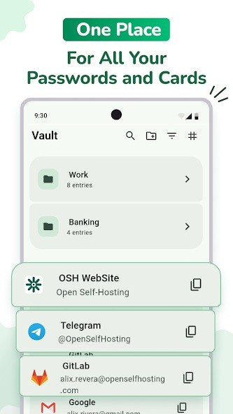
      <p align="center"><sub>Vault</sub></p>
    </td>
    <td width="25%" valign="top">
      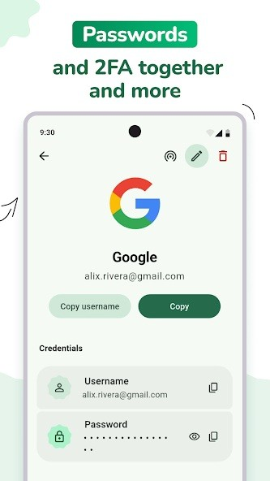
      <p align="center"><sub>Passwords and 2FA</sub></p>
    </td>
    <td width="25%" valign="top">
      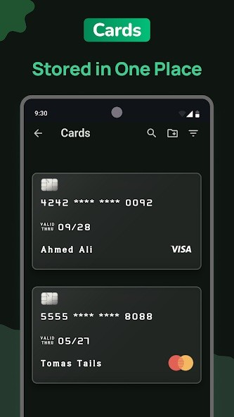
      <p align="center"><sub>Cards</sub></p>
    </td>
    <td width="25%" valign="top">
      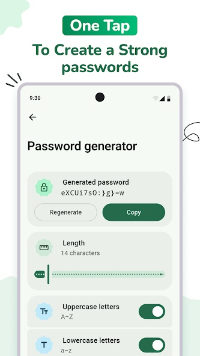
      <p align="center"><sub>Password generator</sub></p>
    </td>
  </tr>
  <tr>
    <td width="25%" valign="top">
      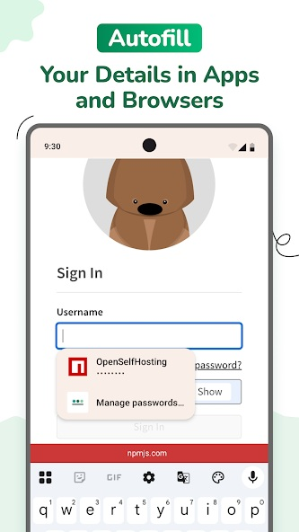
      <p align="center"><sub>Autofill</sub></p>
    </td>
    <td width="25%" valign="top">
      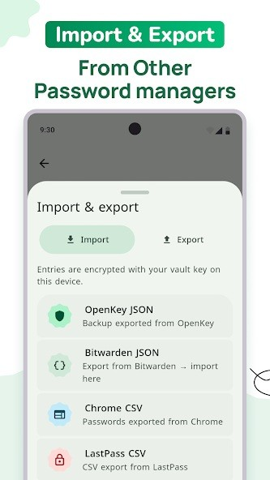
      <p align="center"><sub>Import and export</sub></p>
    </td>
    <td width="25%" valign="top">
      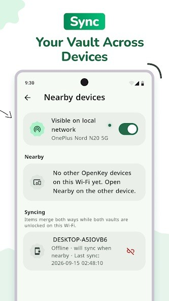
      <p align="center"><sub>Nearby sync</sub></p>
    </td>
    <td width="25%" valign="top">
      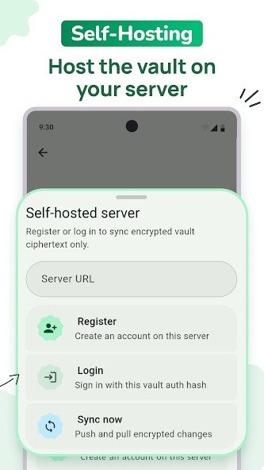
      <p align="center"><sub>Self-hosting</sub></p>
    </td>
  </tr>
</table>

<h3 align="center">Microsoft Store — Windows</h3>

<table>
  <tr>
    <td width="50%" valign="top">
      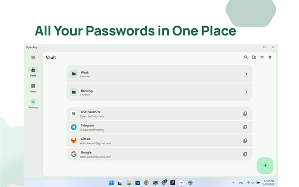
      <p align="center"><sub>Vault</sub></p>
    </td>
    <td width="50%" valign="top">
      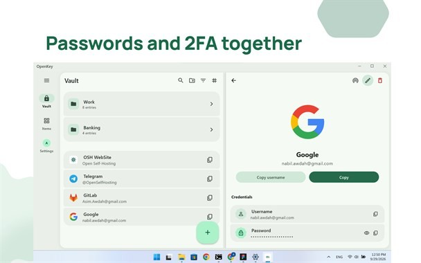
      <p align="center"><sub>Passwords and 2FA</sub></p>
    </td>
  </tr>
  <tr>
    <td width="50%" valign="top">
      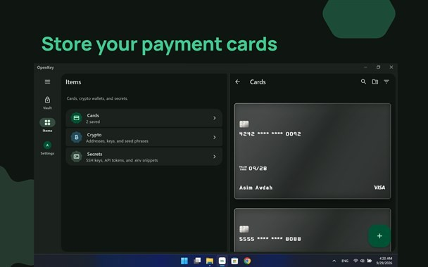
      <p align="center"><sub>Cards</sub></p>
    </td>
    <td width="50%" valign="top">
      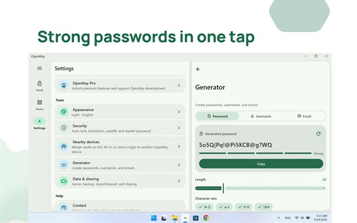
      <p align="center"><sub>Password generator</sub></p>
    </td>
  </tr>
  <tr>
    <td width="50%" valign="top">
      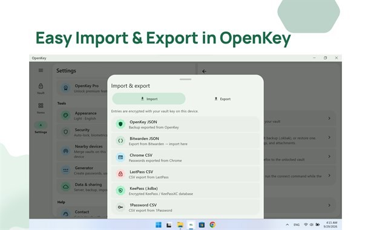
      <p align="center"><sub>Import and export</sub></p>
    </td>
    <td width="50%" valign="top">
      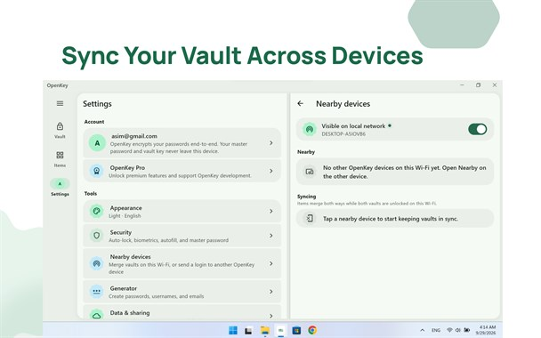
      <p align="center"><sub>Nearby sync</sub></p>
    </td>
  </tr>
  <tr>
    <td width="50%" valign="top">
      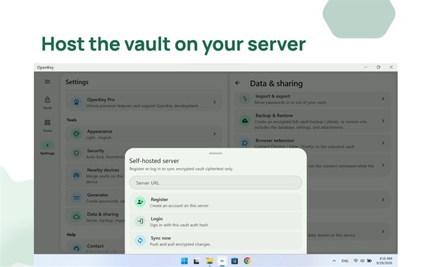
      <p align="center"><sub>Self-hosting</sub></p>
    </td>
    <td width="50%" valign="top">
      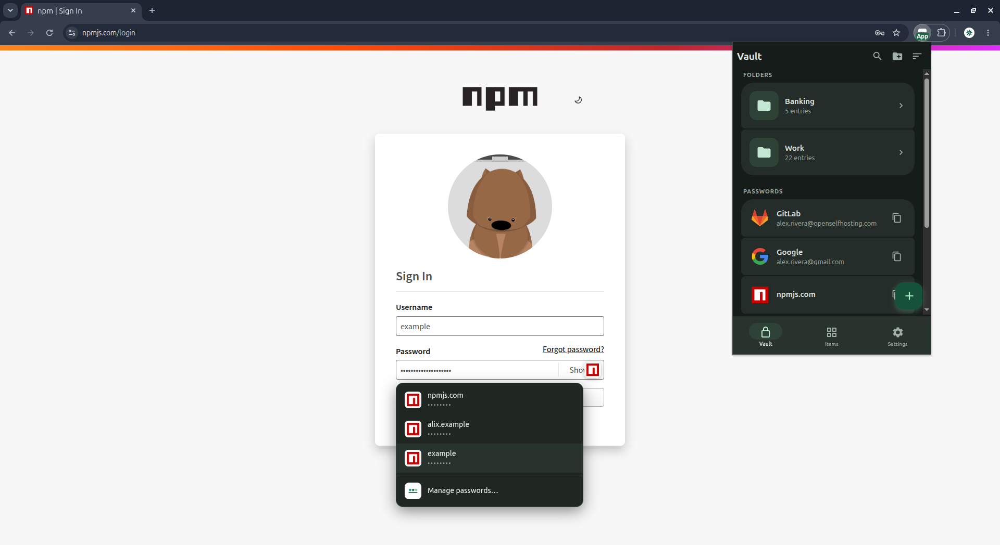
      <p align="center"><sub><strong>Browser autofill</strong> — save and fill credentials</sub></p>
    </td>
  </tr>
</table>
</details>

---

<details>
<summary><strong>OpenKey projects</strong><br></summary>

The ecosystem is modular: the official app works offline, and you can add only the services and tools you need.

| Project | What it does | When to use it |
|---------|--------------|----------------|
| [OpenKey app](https://github.com/OpenSelfHosting/OpenKey) | Official Flutter app for Android, macOS, Linux, and Windows. | Use it as your personal password manager; a server is optional. |
| [OpenKey server](https://github.com/OpenSelfHosting/OpenKey_server) | Self-hosted API for syncing encrypted vault data between devices. | Deploy it when you want server-based sync that you control. |
| [OpenKey browser extension](https://github.com/OpenSelfHosting/OpenKey_extension) | Browser-based vault, autofill, and connection to the unlocked desktop app. | Use it for browser autofill, either standalone with a server or with the desktop app bridge. |
| [OpenKey CLI](https://github.com/OpenSelfHosting/OpenKey_cli) | Terminal tools for password generation and vault items. | Use it in developer workflows with the desktop app bridge or a server session. |
| [OpenKey documentation](https://github.com/OpenSelfHosting/OpenKey_docs) | Product guides and documentation. | Use it for setup instructions and feature guides. |


### How the pieces connect

The app, browser extension, and CLI can each sync with a server. The extension and CLI can also connect to an unlocked desktop app through its local bridge.

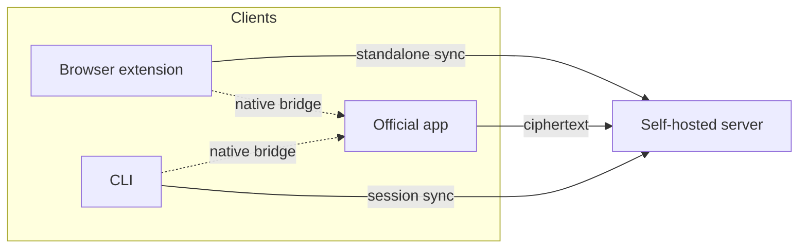

Nearby LAN sync (Pro) is peer-to-peer on the local network. It does **not** go through the API.

The product website is [openkey.openselfhosting.com](https://openkey.openselfhosting.com); the company website is [openselfhosting.com](https://openselfhosting.com). Official app releases are available from [GitHub Releases](https://github.com/OpenSelfHosting/OpenKey/releases) and supported app stores. **OpenKey Pro** subscriptions are sold through app stores. See the [Terms of Service](https://openkey.openselfhosting.com/terms) and [Privacy Policy](https://openkey.openselfhosting.com/privacy) for product and service details.

</details>

---

<details>
<summary><strong>Self-host the sync server</strong><br></summary>

The sync server is optional: personal vaults work offline, and the server is only needed for server-based sync between your devices. It stores encrypted vault data and never receives your master password or plaintext vault key.

### Quick start with Docker

You need a machine with Docker Engine and the Docker Compose plugin. Clone the server repository:

```bash
git clone https://github.com/OpenSelfHosting/OpenKey_server.git
```

Change into the server directory:

```bash
cd OpenKey_server
```

Create the environment file from the provided example:

```bash
cp .env.example .env
```

Generate a unique signing secret and set it as `JWT_SECRET` in `.env`:

```bash
openssl rand -hex 32
```

Keep the generated secret private. The server rejects missing or placeholder secrets.

Start the API and PostgreSQL database:

```bash
docker compose up --build -d
```

Check that the API and database containers are running:

```bash
docker compose ps
```

Check that the API health endpoint responds:

```bash
curl http://localhost:8000/health
```

The local API is at `http://localhost:8000`; interactive API documentation is at [`/docs`](http://localhost:8000/docs). The database data is kept in the Docker volume `openkey_pgdata`, so it survives a normal container restart. Keep separate database backups as well.

### Connect OpenKey

In the app, open **Settings → Data → Self-hosted server**, enter the server's base URL, then register an account or sign in and sync.

- Use `http://localhost:8000` only when the app and server are on the same machine.
- For another device on your network, use the server machine's reachable LAN address or hostname.
- For access over the internet, use your domain with HTTPS (for example, `https://vault.example.com`).
- Use the same server URL and account on each device you want to sync.

### Production deployment

Do not expose the database or the API's raw port directly to the internet. Put the API behind a reverse proxy or load balancer that provides HTTPS, keep PostgreSQL on a private network, and use a unique `JWT_SECRET` of at least 32 characters. Set `CORS_ORIGINS` to the exact browser origins you need—never use `*`. Only enable `TRUST_PROXY_HEADERS` when the trusted proxy overwrites forwarded-address headers.

Review the server's `.env.example` and follow the complete [server installation and production guide](https://openkey.openselfhosting.com/guide/server) before exposing an instance publicly.

> **Nearby sync is separate:** OpenKey Pro can sync directly between nearby devices over the local network; that peer-to-peer transfer does not go through this server.

</details>


---

<details>
<summary><strong>Browser extension</strong><br></summary>

The open-source extension supports Chrome, Edge, Brave, Vivaldi, LibreWolf, and Firefox. Choose the workflow that fits your setup:

- **Standalone vault:** connect to your self-hosted server, unlock the extension with your account, and sync encrypted vault data.
- **Desktop app bridge:** connect to an unlocked OpenKey desktop app to fill and save without a separate extension unlock.

### What you can do

- Autofill logins and payment cards, and capture new or updated logins.
- Use passkeys on supported sites and browsers.
- Browse and manage cards, crypto wallets, and developer secrets.
- In standalone mode, access synced attachments, shares, and organization features where available.

The desktop bridge focuses on filling and managing supported vault items through the unlocked app; server-dependent features such as shares and organization management remain in standalone mode.

### Build and install

Install Node.js, then clone the extension repository:

```bash
git clone https://github.com/OpenSelfHosting/OpenKey_extension.git
```

Change into the extension project directory:

```bash
cd OpenKey_extension
```

Install the extension's dependencies:

```bash
npm install
```

Build the extension. The generated files are written to `dist/`:

```bash
npm run build
```

- **Chrome, Edge, Brave, Vivaldi, and LibreWolf:** open the browser's extensions page, enable Developer mode, choose **Load unpacked**, and select the generated `dist/` directory.
- **Firefox:** open `about:debugging` → **This Firefox** → **Load Temporary Add-on**, then select `dist/manifest.json`. Temporary add-ons may need to be loaded again after Firefox restarts.

Chromium browsers require the extension ID to register the desktop bridge. Follow the platform-specific steps in the [Browser extension guide](https://openkey.openselfhosting.com/guide/extension), then choose **Use desktop app** in the extension.

### Shortcut and permissions

Use **Ctrl+Shift+L** on Windows/Linux or **⌘⇧L** on macOS to fill a login. If another extension uses the shortcut, change it in the browser's extension shortcut settings.

The extension requests access to websites so it can offer autofill, capture login updates, and handle passkeys. Review the browser's permission prompt and the [extension guide](https://openkey.openselfhosting.com/guide/extension#permissions) before installing.

</details>

---

<details>
<summary><strong>Command-line interface (CLI)</strong><br></summary>

The open-source `openkey` CLI brings OpenKey into terminal workflows. Generate passwords offline, manage vault items through an unlocked app, or use an optional self-hosted server session. **Node.js 20+** is required.

### Install

Install the CLI globally:

```bash
npm install -g openkey-cli
```

Check that it is installed:

```bash
openkey --version
```

### Use the unlocked app

Unlock OpenKey on this device first. Check the app bridge and current connection:

```bash
openkey status
```

Generate a 24-character password without symbols. Generation works offline and does not require an unlocked vault:

```bash
openkey gen -l 24 --no-symbols
```

List developer secrets saved in the connected vault. Keep the app unlocked:

```bash
openkey secret list
```

Add a secret directly to the unlocked app's **Secrets** section. This example reads the value from standard input rather than a command-line argument:

```bash
printf '%s' "$TOKEN" | openkey secret add --name "GitHub token" --kind apiToken --stdin
```

Scan this machine for developer secrets such as SSH keys, `.env` values, environment variables, and AWS credentials. Preview findings without saving:

```bash
openkey discover --dry-run
```

Save discovered secrets directly into the connected vault, grouped by device. Review the preview first and keep OpenKey unlocked:
```bash
openkey discover -y
```

Search vault items by a term:

```bash
openkey search api
```

Retrieve a specific field from a matching item:

```bash
openkey get "GitHub" --field username
```

Diagnose the CLI, app bridge, and server connection:

```bash
openkey doctor
```

### Use a self-hosted server

Point the CLI at your server. Replace the example URL with your server's HTTPS URL:

```bash
openkey config set-server https://vault.example.com
```

Sign in to your server account. The master password is requested interactively:

```bash
openkey login --email you@example.com
```

Start a short-lived CLI session. The command prints shell instructions; `eval` applies them to the current shell:

```bash
eval "$(openkey unlock)"
```

Pull and push encrypted vault changes:

```bash
openkey sync
```

Lock the CLI session when you are finished:

```bash
eval "$(openkey lock)"
```

Never pass your master password as a command-line argument. For scripts, the CLI supports `OPENKEY_PASSWORD`; provide it through a secret manager rather than committing it to files.

### Android with Termux

The CLI can connect to the unlocked Android app from Termux. In OpenKey, open **Settings → Data → Termux / CLI** and follow the displayed setup instructions. The bridge port and token are temporary and change after the vault is locked.

Prefer `--stdin` or file input for secret values instead of including them directly in commands, where they may be saved in shell history or visible to other local processes. `list` and `search` mask secret values; use `get` or `copy` when you need to reveal one. Clipboard copies clear automatically after 45 seconds by default.

See the [CLI guide](https://openkey.openselfhosting.com/guide/cli) for all commands, configuration, shell completions, scripting, and platform-specific setup.

</details>

---

<details>
<summary><strong>Security</strong><br></summary>

Report vulnerabilities **privately** to **security@openselfhosting.com** — do not open a public issue for exploitable bugs. See [SECURITY.md](./SECURITY.md).

</details>

---

<details>
<summary><strong>Contributing</strong><br></summary>

Issues and pull requests for bugs, documentation, and improvements are welcome.
Include focused tests with code changes. For security vulnerabilities, use the private reporting
instructions in [SECURITY.md](./SECURITY.md) instead of opening a public issue.

</details>

---

<details>
<summary><strong>License</strong><br></summary>

The OpenKey app and documentation in this repository are licensed under the [MIT License](./LICENSE). Vendored and third-party dependencies retain their respective licenses.

</details>
